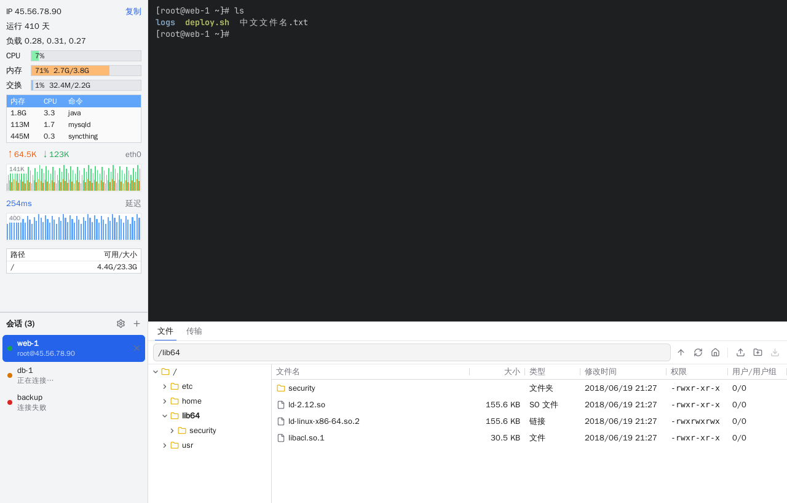

# Finalshelly

一个仿 FinalShell 布局的 SSH 客户端，纯 Go 编写。界面用 [MyGo](https://github.com/egoist/mygo) 的原生 UI，终端是 MyGo 的 terminal 插件（底层 libghostty-vt，运行时加载，不需要 cgo）。

和 FinalShell 的区别：会话标签是竖向的，放在左下角，可以滚动、拖动排序。



## 运行

需要 Go 1.27.3+。

```sh
go tool mygo dev     # 开发模式，改代码自动重启
go tool mygo build   # 打包到 build/<平台>/
go test ./...
```

第一次 `go run` / `go test` 会把 libghostty-vt 下载到用户缓存目录；`mygo build` 打包的应用自带这个库。

用真实服务器跑集成测试（连接、终端、监控、拖拽上传、下载）：

```sh
FINALSHELLY_TEST_SSH=user:password@127.0.0.1:22 go test ./internal/app -run SSH -v
```

隧道的测试（`internal/sshx` 的 `TestTunnels`、`internal/app` 的 `TestSSHTunnels`）也用这个变量，服务器要在本机（远程隧道的端口从本机去连）并允许 TCP 转发（`AllowTcpForwarding yes`）。不设变量时它们用进程内的测试服务器（`internal/sshtest`）。

## 功能

- 中文和英文界面。默认跟随系统语言，点左下角“会话”标题旁的齿轮按钮打开“选项”窗口，在“常规”页切换，选择会保存。
- “选项”窗口（和 FinalShell 一样，左边是页面树，右边是页面）。“常规”页：
  - 界面语言：跟随系统 / English / 简体中文。
  - 自动选中标签（默认开）：新连接打开后切换过去。关掉后新会话在后台打开，当前会话保持选中；没有选中的会话时仍然选中新的。
  - 关闭时最小化到托盘（默认关）：点主窗口的关闭按钮时隐藏到托盘图标（macOS 是菜单栏），图标菜单里有“显示主窗口”和“退出”。Windows 上左键单击图标也能显示窗口，macOS 上点 Dock 图标也能显示。系统没有托盘时（Linux 没装 `libayatana-appindicator3`）按没开这一项处理。
  - 关闭窗口前确认（默认开）：有会话已连接或正在连接时，关闭主窗口或退出（托盘菜单、macOS 的 Cmd+Q）之前用系统的消息框问一次。同时开了托盘：关闭按钮直接隐藏，不问；“退出”才问。
  所有选项改了立刻保存在 `settings.json`，除了下面“鼠标”页说的两项，也立刻生效。
- 选项的“传输”页：下载目录（“更改…”、“使用默认”），“每次下载时询问保存位置”（默认关）。在 `settings.json` 里是 `downloadDir`（没有是系统的下载文件夹；选回系统的下载文件夹也存成没有）和 `askDownloadDir`。下载目录被删掉了，下载时会重新创建。
- 选项的“终端 › 鼠标”页，用的都是 terminal 插件本身的功能：
  - 选中即复制（默认关）：用鼠标选中文字（还有“全选”）后自动复制到剪贴板。
  - 右键：显示右键菜单（默认）/ 粘贴 / 复制选中的文字 / 有选中的文字时复制、没有时粘贴 / 不做任何操作。服务器上的程序接管鼠标时（比如开了 `mouse=a` 的 vim）右键交给程序，按住 Shift 才按这里的设置。
  - Ctrl+单击打开链接（macOS 是 Cmd+单击，默认开）：终端里显示的网址和 OSC 8 超链接用系统浏览器打开。关掉后单击链接什么也不做；插件没有关掉链接识别的开关，所以按住 Ctrl 时链接仍然显示下划线（文件路径也会显示），只是不打开。
  - 鼠标滚轮每格滚动行数（1 到 20，默认 3）：只管鼠标滚轮，不改触控板。Windows 上 3 对应系统鼠标设置里的“一次滚动的行数”，其他值按比例换算。
  - 选中即复制和滚动行数在已打开的终端里立刻生效（插件有 `SetCopyOnSelect`、`SetScrollMultiplier`）。右键和链接插件只在创建终端时读取，没有 setter，所以已打开的会话重新连接后才生效；重建正在用的终端会丢掉屏幕和滚动历史，所以不这么做。
  - 在 `settings.json` 里是 `copyOnSelect`、`rightClick`（`paste`、`copy`、`copy-or-paste`、`ignore`；没有或不认识的值是右键菜单）、`noLinkClick`、`wheelLines`（没有是 3，超过 20 按 20）。
  - 没有中键粘贴：插件只把中键交给接管鼠标的程序，自己不处理，也不公开程序是否接管了鼠标，应用另外处理中键的话，程序会同时收到中键和粘贴的文字。插件也没有 Linux 的 PRIMARY 选区。要做需要插件加一个像 `RightClick` 那样的中键选项。
- 选项的“终端 › 快捷键”页：表格列出每个操作、现在的快捷键和默认的快捷键（见下面的快捷键表）。选中一行点“修改…”，在弹出的框里按下新的组合键，“确定”保存；“使用默认”填回默认键，“恢复默认”恢复选中的一行，“全部恢复默认”恢复所有。
  - shell 需要的键不让用，框里用红字说明原因：不带修饰键（或只带 Shift）的键；只带 Ctrl 的字母、数字、标点、空格和方向键等（Ctrl+C、Ctrl+R、Ctrl+W、Ctrl+←……）；只带 Alt 的这些键（Alt+B、Alt+F 在 shell 里是 Meta，按词移动）；macOS 上只带 Option 的这些键（会输入字符）；Windows 上 Ctrl+Alt 加字母（就是 AltGr，很多键盘布局用它输入字符）；系统占用的键（macOS 的 Cmd+Q、Cmd+H、Cmd+M、Cmd+Tab、Cmd+空格等，Windows/Linux 的 Alt+Tab、Alt+F4，Windows 上的 Win 键组合）。例外：“切换到第 N 个标签”可以用 Alt 加数字（readline 的数字参数很少用，GNOME Terminal 也这样），“重新连接”可以用任何键（它只在会话断开、没有 shell 的时候起作用）。
  - 和别的操作冲突时用黄字提示，“确定”后那个操作变成没有快捷键（显示“无”）。和终端自己的键（Ctrl+Shift+A 全选、Ctrl+= 缩放、Shift+PageUp 滚动、Ctrl+Insert / Shift+Insert 复制粘贴）冲突时也提示，确定后归这个快捷键。
  - 窗口的快捷键立刻生效。终端的复制、粘贴是 terminal 插件的 `Keybinds`，插件只在创建终端时读取，所以改了之后新连接（包括重新连接）的会话才生效。
  - macOS 上这一页还有“将 Option 用作 Alt（Meta）键”（默认关，插件的 `OptionAsAlt`）：开了之后 Option+B 发送 Esc b，而不是输入 ∫。同样对之后连接的会话生效。
  - 在 `settings.json` 里只存改过的键：`"shortcuts": {"find": "Ctrl+Alt+F", "closeTab": "none"}`，键名是 `copy`、`paste`、`find`、`fullScreen`、`reconnect`、`previousTab`、`nextTab`、`closeTab`、`connectionManager`、`newTab`、`switchTab`（值像 `"Alt+1-9"`），`Super` 在 macOS 上是 Cmd，`none` 是没有快捷键；没有或读不出来的就是默认。Option 用作 Alt 是 `optionAsAlt`。
- 终端查找（Ctrl+Shift+F，macOS 是 Cmd+F）：终端右上角出现查找栏（MyGo 的 `ui.FindBar`），边输入边用插件的 `Search` 搜屏幕和滚动历史，高亮所有匹配，显示“第几项，共几项”。回车到下一个（往上，更早的输出），Shift+回车到上一个，F3 / Shift+F3（macOS 是 Cmd+G / Shift+Cmd+G）也行；Esc 或“完成”关闭，结束搜索，键盘回到终端。再按一次快捷键时全选查找框里的文字。每个会话的查找栏分开。不区分 ASCII 字母大小写（插件就是这样）。
- 全屏（Ctrl+Shift+Enter，macOS 是 Cmd+Enter）：隐藏左边栏和下面的文件面板，只留终端，窗口也进入系统的全屏；再按一次退出。Esc 只在没有 shell 接收它时退出全屏（新标签页、断开的会话），连接着的终端里 Esc 照常发给 shell（vi 要用）。窗口本来就是系统全屏的，退出时保持系统全屏；用系统的办法（macOS 的绿色按钮）退出系统全屏，也一起退出程序的全屏。
- 选项的“终端 › 字体”“终端 › 配色”“终端 › 背景图片”三页管终端的外观，改了立刻应用到所有打开的终端（`SetFont`、`SetTheme`），新开的终端也用新设置；连接过程中改了，连上后也会补上。每页下面有“恢复默认”，上面有预览（用界面控件画的示例提示符、彩色 `ls`、带连字的代码，用的是同样的字体、配色和背景）。
  - 字体：字体名称（输入时提示系统里已安装的等宽字体，来自 `ui.FontFamilies`；可以写逗号隔开的多个，用第一个装了的；空着是默认的 JetBrains Mono, Cascadia Mono, Consolas, Menlo, DejaVu Sans Mono, monospace）、字号（6 到 48，默认 13.5）、行高（字体本身行高的 0.8 到 2 倍，默认 1）、粗细（细 300 / 常规 400 / 中等 500 / 半粗 600 / 粗 700；插件的粗体总是比它重 300、至少 700，没有单独的粗体粗细）、连字（默认开，关掉是 `-calt`、`-liga`）。改字体会结束终端里的 Ctrl+= 缩放；只改配色不会。
  - 配色：Ghostty 自带的几百个主题（`terminal.GhosttyThemes()`，也包括 Ghostty 主题目录里用户自己的），搜索框按名称过滤，每行带背景色和几种颜色的小样，预览下面是 16 种 ANSI 颜色。默认 Tomorrow Night；主题文件不见了时用默认的。界面一直是浅色，插件的 `DarkTheme` 只在深色窗口里用，所以只有一个选择，同时设给 `Theme` 和 `DarkTheme`。
  - 背景图片：“选择…”用系统的打开对话框选 PNG、JPEG、GIF、WebP 或 BMP（文件 64 MB 以内，最多 1 亿像素），先解码确认能显示，再复制一份到配置目录（`finalshelly/background-<时间>.<扩展名>`），所以原图移走、删掉都没关系；换图或“移除”会删掉旧的副本。填充方式：铺满（裁剪）/ 完整显示 / 平铺；不透明度 5% 到 100%（默认 30%）。不是图片、读不了的文件只显示错误，不复制、不替换现在的图；副本不见了（或 `settings.json` 里的名字不是副本）时显示“背景图片不见了”，可以重新选择或移除。图片的读取和解码都不在界面线程上：启动时不读，第一次要显示时在 goroutine 里读，读完再通过 `App.post` 显示，没读完时终端只显示配色的背景色；读的过程中换了或移除了图片，旧的结果直接丢掉。超过 3840 像素（长边）的图片缩小后再保存在内存里（副本仍是原文件），JPEG 按 EXIF 方向摆正。
  - 实现：终端都用 `Transparent: true` 创建，应用自己在终端下面画背景：先是配色的背景色，再画图片，再盖一层 (1 − 不透明度) 的背景色，所以文字一直在配色背景上。程序自己设的背景色（OSC 11、单元格背景）照常画。
  - 在 `settings.json` 里是 `termFontFamily`、`termFontSize`、`termLineHeight`、`termFontWeight`、`termNoLigatures`、`termTheme`、`termBackground`（副本的文件名）、`termBackgroundFit`（`contain`、`tile`；没有是铺满）、`termBackgroundOpacity`（百分比）；没有就是默认值。
- 连接管理器（macOS 上 Cmd+O，其他系统 Ctrl+Shift+O，可以在“快捷键”页改）是单独的窗口，和 FinalShell 一样是文件夹和连接的树，列是名称、主机、端口、用户名、备注（只显示第一行），点列头排序，拖列头边缘改宽度。主机列表存在 `<用户配置目录>/finalshelly/hosts.json`，密码从不写进去，存在系统的凭据存储里（见下面的“密码存在哪里”）。
  - 工具栏：新建连接、新建文件夹（建在选中的文件夹里，选中的是连接就建在它所在的文件夹里）、全部折叠、全部展开、导入（从 FinalShell 导入，见下面）、“显示已删除”、文件夹筛选（“全部”或只看某个文件夹）、搜索框。下面是“连接后关闭窗口”（默认勾选，记在 `settings.json` 的 `keepManagerOpen` 里，没有这一项就是关闭）。
  - 搜索边输入边过滤，按名称、地址、用户名、备注匹配（每个词都要匹配，不分大小写），自动展开含有结果的文件夹并选中第一个结果，回车连接它；清空搜索后恢复原来展开的文件夹。
  - 双击或回车连接：在主窗口打开会话（主窗口选中的是新标签页时就连在那个标签页里），把主窗口提到前面，勾选了“连接后关闭窗口”就关掉连接管理器。
  - 连接的右键菜单：连接、编辑、复制连接（名称加“ - 副本”，代理或跳板机设置、隧道、记住的密码和代理密码也一起复制，凭据存储里的也复制到新连接下）、重命名（F2）、移动到文件夹、复制主机地址、删除（Delete 键）。文件夹的右键菜单：新建连接、新建子文件夹、重命名、移动到文件夹、删除。删除文件夹前先问，里面的连接和子文件夹移到它的上一级（顶层的文件夹就移到顶层），提示里会写明。
  - 把连接或文件夹拖到文件夹那一行就移进去，拖到连接那一行就移到那个连接所在的文件夹，拖到空白处移到顶层；文件夹不能拖进自己或自己的子文件夹。
  - 删除连接只是移到“已删除”（`deletedAt`），勾选“显示已删除”后灰色显示在原来的文件夹里，右键可以“恢复”或“彻底删除”（先问）。彻底删除都走 `deleteHostForever`，同时清掉为这个主机记住的密码和代理密码，内存里的和凭据存储里的都清掉。删除（或彻底删除）别的连接正在用的跳板机时先问，提示里列出哪些连接会因此连不上；跳板机的下拉框本来就只列没删除的连接。
  - 从连接管理器打开的连接编辑器是它的模态窗口（见下面的“子窗口”），保存后连接管理器里马上显示并选中这个连接。
  - 从 FinalShell 导入（工具栏的“导入”）：打开一个连接管理器的模态窗口，自动找 FinalShell 的数据目录（里面有 `conn` 文件夹的那个），按顺序试：
    - Windows：`%LOCALAPPDATA%\finalshell`、`%APPDATA%\finalshell`、`%ProgramFiles%\FinalShell`、`%ProgramFiles(x86)%\FinalShell`、`C:\finalshell`（FinalShell 装在别的目录、数据也在安装目录里时，要自己选）
    - macOS：`~/Library/FinalShell`、`~/Library/Application Support/finalshell`
    - Linux：`~/.finalshell`、`~/.local/share/finalshell`

    找不到就弹出选择文件夹的对话框（显示隐藏文件夹），可以选数据目录、它的 `conn` 文件夹，或者 FinalShell 导出的文件夹；窗口顶上的“选择文件夹…”随时换一个。读文件在 goroutine 里，读完通过 `App.post` 显示。
  - 窗口里列出所有 SSH 连接（名称、主机、用户名、文件夹、说明），每行一个复选框，默认全选，“全选”“全不选”，回车、双击或空格切换选中的一行。和已有主机地址（不分大小写）、端口、用户名都相同的连接灰色显示“已存在”，不能勾选，不会导入；FinalShell 里两条相同的，只导入第一条。读不了的文件（不是 JSON、太大、读取失败、没有主机地址）算失败，RDP/VNC 等非 SSH 连接和 FinalShell 里已删除的连接算跳过，都列在表格下面。
  - 点“导入 N 个”：按 FinalShell 的文件夹结构放进同名文件夹（从顶层逐级按名称找，已有的就用，没有就新建，只建有连接导入的文件夹），关掉窗口，在连接管理器里展开这些文件夹、选中第一个导入的连接，底部显示导入、跳过、失败各多少个。
  - 导入的字段：名称、主机、端口、用户名、备注（`description`）、文件夹、认证方法、是否启用 exec 通道（关掉的导入后关闭服务器监控）。添加时间（`createdAt`）记为导入的时间，不用 FinalShell 的 `create_time`，所以导入的连接排在快速连接“其他连接”的前面。密码不导入：FinalShell 把密码加密存在文件里，这里不解密，也不读这个字段，第一次连接时会询问（默认记住，存进系统的密钥库）。私钥认证的连接导入后是“私钥”认证但没有私钥文件：FinalShell 把私钥存在它自己的 `config.json` 里，连接只记着私钥的 ID，这个文件不读，要编辑连接选私钥文件。代理（`proxy_id` 指向 FinalShell 自己的代理列表）、端口转发、终端编码、退格键设置都不导入，用了代理的连接在“说明”里注明。
  - FinalShell 的文件格式没有官方文档，按其他开源客户端（Hatoba、LiteShell、MeatShell、OpenFinalShell）的 FinalShell 导入代码整理，写在 `internal/importer/finalshell.go` 的注释里。解析尽量宽松：不认识的字段忽略，缺的字段用默认值（端口 22、密码认证），端口写成字符串也认。
- 新标签页（启动时打开一个）：“快速连接”列出所有没删除的主机（名称、主机、用户名）：先是最近连接过的（最多 30 个），最后连接的在最上面；下面是其他主机，最后添加的在最上面（新建、复制、从 FinalShell 导入时记下添加时间 `createdAt`），没有添加时间的旧主机排在最后，按保存的顺序。两部分都有时上面分别标着“最近连接”“其他连接”。所以刚添加的主机不用先连接一次，马上就出现在这里。点一下或按回车就在这个标签页里连接，同一行变成会话。搜索框边输入边过滤，按名称、地址、用户名、备注匹配，顺序和不搜索时一样，上下方向键选择（跳过“最近连接”“其他连接”这两行）。“清空”清掉最近连接记录，不删主机，它们都还列在“其他连接”里。“连接管理器”按钮打开连接管理器；在新标签页选中时从连接管理器连接，也连在这个标签页里。一个主机都没有时显示“新建连接”按钮。
- 连接编辑器（新建连接 / 编辑连接）是单独的窗口，左边是页面，下面是“确定”“取消”：
  - “SSH 连接”：名称、主机、端口、备注（多行），认证方法（密码或私钥）、用户名、密码或私钥文件（“浏览…”选文件）和私钥密码，“记住密码”（私钥是“记住私钥密码”，默认开），“启用 exec 通道（服务器监控）”。错误提示显示在对应的输入框下面。
  - “终端”：终端类型（发给服务器的 `TERM`，默认 `xterm-256color`）；退格键发送 `^?`（DEL，默认）或 `^H`，同时把服务器终端的 erase 字符设成一样的；字符编码目前只有 UTF-8（libghostty-vt 只解码 UTF-8，程序也不做转码）。
  - “代理”：类型选“不使用”（直接连接）、SOCKS5、HTTP 或“跳板机”。
    - SOCKS5 和 HTTP（`CONNECT`）填代理的主机、端口（默认 1080 / 8080），代理需要认证时填用户名和密码（HTTP 是 Basic 认证）。SOCKS5 由代理解析主机名，所以主机可以填只有代理那边认识的名字。
    - “跳板机”从已保存的其他连接里选一个（不能选自己），相当于 `ssh -J`：先登录跳板机，再由跳板机的 SSH 服务器转发到这台主机（跳板机要允许 TCP 转发）。跳板机自己也可以设代理或跳板机，按顺序一跳一跳连过去；绕回来形成循环时，编辑器和连接时都会提示 “跳板机形成了循环：a → b → a”。
    - 每一跳都和直接连接它一样：第一次连接时确认它的主机指纹，用它自己的登录方式和密码。连接时，还不知道的密码按顺序一个一个问：先问主机自己的，再问它的代理的，再问各个跳板机的（标题写“输入跳板机密码”或“输入代理密码”，下面写是哪个主机、为了连接谁）。主机改成走跳板机后重新连接，也会先问新跳板机的密码。
    - 代理密码和主机密码一样存在系统的凭据存储里（跟着“SSH 连接”页的“记住密码”），不写进 `hosts.json`。
    - 出错时说明是哪一跳：“代理 1.2.3.4:1080：连接被拒绝：端口没有开放代理服务”“跳板机 web-1：认证失败：…”“跳板机 web-1：无法连接到 10.0.0.5:22：…”。
    - 关闭或断开会话时，跳板机的连接一起关闭。
  - “隧道”：SSH 端口转发，表格列出类型、监听地址、转发目标和“启用”，下面是“添加…”“编辑…”“移除”（双击一行也是编辑）。添加和编辑在一个对话框里：
    - 本地（`-L`）：在本机监听，每个连接经服务器转发到目标（目标地址按服务器那边解析）。
    - 远程（`-R`）：在服务器上监听，每个连接转回本机，再由本机连到目标。
    - 动态（`-D`）：本机的 SOCKS5 代理，由服务器去连客户端要访问的地址。只支持 CONNECT、不需要认证，地址可以是 IPv4、IPv6 或域名（域名由服务器解析）。SOCKS5 服务端是自己写的一小段（`sshx/forward.go`），现有依赖里没有现成的。
    - 默认只监听 `127.0.0.1`（远程隧道是服务器的 `127.0.0.1`），只有同一台机器能连。勾选“允许其他计算机连接”才能填别的监听地址（默认 `0.0.0.0`），同时显示警告：谁都能用这条隧道，不需要登录；远程隧道还要服务器的 `GatewayPorts` 允许。远程隧道的监听地址只能是 IP 地址（IPv4 或 IPv6）或 `localhost`（就是 `127.0.0.1`）：SSH 库会在本机解析主机名，而不是在服务器上，所以不接受主机名；手改 `hosts.json` 写了主机名的，启动时这条隧道报错，说明原因。表格里这样的隧道带一个警告图标。
    - 端口必须是 1 到 65535，目标主机必填；同一台机器上已有隧道监听同一个端口时提示“已有另一条隧道监听这个端口”。“随会话启动”关掉的隧道不自动启动，但可以在“隧道”页手动启动。
  - 回车等于“确定”（备注里回车是换行），Esc 等于“取消”。同时只开一个编辑器：已经开着时再点新建或编辑，只会把开着的那个提到前面，里面没保存的内容不会丢。修改已经打开会话的主机，下次连接时生效。编辑期间主机在连接管理器里被删除了，“确定”只提示“此连接已被删除”，不会把它存回去。
- 连接成功时记下时间，供“最近连接”使用。主机的 `noMonitor` 为 `true` 时不轮询服务器状态，也就不开额外的 exec 通道（有些跳板机不允许）。
- 第一次连接时弹窗显示主机指纹，信任后记入 `finalshelly/known_hosts`；指纹变化时拒绝连接。
- 左上：当前会话服务器的 IP、运行时间、负载、CPU/内存/交换、内存占用前几的进程、网速和延迟曲线、磁盘。每 2 秒通过 SSH 读取一次 `/proc`，只支持 Linux 服务器。
- IP 下方的“系统信息”按钮：弹出主机名、系统（`/etc/os-release`）、内核、架构、CPU 型号和核数、内存、运行时间、IP 地址、硬盘，“复制”按钮把这些复制成纯文本。每次打开时通过一个 exec 通道读取一次，用一段 POSIX sh 脚本，BusyBox 也能跑，缺 `lscpu`、`nproc`、`ip` 之类的工具时跳过或换用别的。未连接时左上显示 FinalShell 那样的空白占位（“-”、0%）。
- 左下：竖向会话列表，状态点（绿：已连接，黄：连接中，红：失败），右键菜单（重新连接、复制会话、断开、关闭），拖动排序。“+”按钮新开一个新标签页；新标签页和会话一样可以切换、拖动、关闭，标题里的数目不算新标签页。全部关掉后右边仍显示快速连接，在那里连接会新开一个标签页。
- 右上：终端。断开后保留最后的画面，顶部出现“重新连接”。
- 右下“文件”页：SFTP 浏览，左边目录树，右边文件表格（可多选），路径栏可以直接输入路径。
- 文件图标主题：文件面板按文件名显示图标（`docker-compose.yml` 是 Docker 图标，`main.go` 是 Go 图标，`src/` 是 src 文件夹，展开的文件夹换成打开的样子），用的是 VS Code 的文件图标主题格式，所以 VS Code 的图标主题都能用。在选项的“文件管理 › 文件图标主题”页选择，上面有预览，选了立刻生效。
  - 内置：Material Icon Theme（默认）、Seti（VS Code 自带的那个），以及“简洁”（只有文件和文件夹两个图标，就是以前的样子）。
  - “从 VSIX 安装…”：选一个 `.vsix` 文件（VS Code 扩展包，比如从 [Open VSX](https://open-vsx.org) 下载的），确认它有能读的图标主题后原样复制到配置目录的 `icon-themes/<发布者>.<名称>.vsix`，同一个扩展的新版本替换旧的；装好后自动选中。最大 50 MB。列表里的删除按钮删掉这个副本。
  - 自动列出 VS Code、VS Code Insiders、VSCodium、Cursor、Windsurf 里已经装了的图标主题（`~/.vscode/extensions` 等，Windows 上在 `%USERPROFILE%` 下），直接读，不复制；已卸载的（`.obsolete`）跳过，同一个扩展只列最新版本。“刷新”重新查找。选中的主题后来不见了或读不出来时显示 Material Icon Theme，并在选项页说明原因。
  - 只读取主题的 JSON 和它引用的 SVG、PNG、字体，扩展里的代码不会运行；引用到扩展外面的路径直接忽略。用字体做图标的主题（Seti 用 WOFF，file-icons 用 WOFF2）先转成 TrueType 再注册给界面。按 VS Code 的规则匹配：先文件名，再扩展名（最长的优先，`a.test.ts` 先找 `test.ts`），再语言（文件名到语言的对应表来自 VS Code 自带的语言扩展），最后是默认的文件图标；界面是浅色的，所以用主题的 `light` 部分。
  - 在 `settings.json` 里是 `fileIconTheme`：没有是 Material，`minimal` 是简洁，`bundled:seti` 是 Seti，其他是 `<发布者>.<名称>/<主题 ID>`。
  - 内置的两个主题都是 MIT 协议，许可证在各自的 VSIX 里（`internal/fileicons/bundled/`）。更新它们和语言表：改 `internal/fileicons/internal/gen` 里的版本号，运行 `go generate ./internal/fileicons`（需要 git 和网络）。
- 上传：把文件或文件夹从资源管理器 / Finder 拖到文件表格（传到当前目录）或目录树的某个文件夹上；也可以用工具栏的上传按钮或右键菜单选文件、选文件夹。
- 下载：选中文件或文件夹，点下载按钮（存到下载目录，默认是系统的“下载”文件夹 `~/Downloads`，可以在选项的“传输”页修改），或右键“下载到…”自己选位置。“传输”页勾选“每次下载时询问保存位置”后，下载按钮每次都先用系统的选择文件夹对话框问保存位置。
- 右下“隧道”页：当前会话的隧道，每条显示状态（正在启动、监听中、已停止，或出错的原因，比如“端口 127.0.0.1:8080 已被占用”“服务器没有监听 …：端口在服务器上已被占用，或不允许转发”）、当前和累计连接数、上下行字节数，以及上一个连不上目标的连接的原因。每行有“启动”/“停止”。标签上的数字是正在监听的隧道数。会话连接成功后启动已启用的隧道，某条隧道失败（比如端口被占用）只影响它自己，会话照常连接；断开、连接断掉或关闭会话时全部停止并释放端口，重新连接时按主机当前的设置重新启动。经过代理或跳板机连接时，隧道走的是到这台主机本身的连接。“编辑隧道…”打开连接编辑器的“隧道”页。
- 右下“传输”页：进度、速度、剩余时间、取消；同时最多跑 3 个，其余排队。目标位置已有同名项目时先询问是否覆盖。失败或取消的可以“重试”（同一个会话，用它现在的连接重新排队；会话已关闭或未连接时不能重试），下载完成后可以“打开”（用系统默认的程序；没有能打开它的程序时在文件夹中显示）和“在文件夹中显示”。
- 文件面板工具栏最右边的“下载列表”按钮（和 FinalShell 一样）：有传输在进行时按钮上显示数目。点开是一个弹出框，第一行是下载目录（太长时省略中间部分）、“更改…”和“在访达中显示”（Windows 是“在资源管理器中显示”，Linux 是“在文件夹中显示”，目录不存在时先创建）；下面是最近的传输（上传和下载），最新的在最上面，每行和“传输”页一样，底部是“清除已完成”。弹出框和“传输”页是同一个队列，“传输”页按开始的顺序排，弹出框反过来。
- 应用图标：有传输在进行时，macOS 的 Dock 图标显示数目和总进度（正在跑、已知大小的传输的字节数），Windows 的任务栏按钮显示总进度（MyGo 在 Windows 上没有图标角标），支持 Unity launcher API 的 Linux dock 两样都显示；全部结束后清除。进度每秒最多更新 4 次，数目一变立刻更新。
- 拖动区域之间的分隔条调整大小（获得焦点后也可以用方向键），双击恢复默认大小。每个区域有最小尺寸，不会被拖到看不见；大小保存在 `finalshelly/settings.json`，下次启动恢复。

快捷键（默认，和 FinalShell 一样，都可以在“终端 › 快捷键”页修改）：

| 操作 | macOS | Windows / Linux |
|---|---|---|
| 终端：复制 | Cmd+C | Ctrl+Shift+C |
| 终端：粘贴 | Cmd+V | Ctrl+Shift+V |
| 终端：查找 | Cmd+F | Ctrl+Shift+F |
| 终端：全屏 | Cmd+Enter | Ctrl+Shift+Enter |
| 终端：重新连接（会话断开时，焦点在终端区域） | Enter | Enter |
| 上一个标签 | Cmd+[ | Ctrl+Shift+Tab |
| 下一个标签 | Cmd+] | Ctrl+Tab |
| 关闭标签 | Cmd+W | Ctrl+Shift+W |
| 连接管理器 | Cmd+O | Ctrl+Shift+O |
| 新标签页 | Cmd+T | Ctrl+Shift+T |
| 切换到第 1–9 个标签 | Cmd+1…9 | Alt+1…9 |

- 以前 Ctrl+Shift+T 打开连接管理器，现在和别的终端程序一样是新标签页；新标签页上就有最近的连接和“连接管理器”按钮。连接管理器改成 Ctrl+Shift+O。
- 关闭标签在 macOS 上是 Cmd+W，不是 FinalShell 的 Cmd+Q（那是退出）。为了让 Cmd+W 到达窗口，macOS 上的菜单栏去掉了 MyGo 默认的“文件”菜单（里面的“关闭窗口”占着 Cmd+W）。主窗口里 Cmd+W 关闭标签；子窗口（选项、连接编辑器）里 Cmd+W 关闭这个子窗口，和别的 Mac 程序一样（“关闭标签”改成别的键后，那个键也关闭子窗口），Esc 也照样关闭。Windows 和 Linux 上子窗口用 Esc 和系统的关闭按钮。
- macOS 上切换标签只用 Cmd+数字：Option+数字会输入字符（¡™£……）。
- Windows 上 terminal 插件默认还把 Ctrl+C（有选中时复制）和 Ctrl+V（剪贴板有内容时粘贴）绑成复制粘贴，这里去掉了，和 Linux 一样留给 shell（中断、原样输入下一个键）。复制粘贴用 Ctrl+Shift+C / Ctrl+Shift+V，或 Ctrl+Insert / Shift+Insert。
- 只带 Ctrl 的字母键都是 shell 的（Ctrl+A……Ctrl+Z 等），在 Windows/Linux 上不当快捷键用。MyGo 的 legacy 键盘模式下 Ctrl+[、Ctrl+I、Ctrl+M 什么也不发送，是上游的问题（#21），这里没有绕开。

## 配置文件

`hosts.json` 从第 2 版起是一个对象（第 1 版是主机数组，第一次读取时自动迁移，原文件另存为 `hosts.v1.json`，下次保存时改写成第 2 版）：

```json
{
  "version": 2,
  "folders": [{"id": "f1", "name": "生产"}, {"id": "f2", "name": "数据库", "parent": "f1"}],
  "hosts": [{
    "id": "h1", "name": "web", "addr": "203.0.113.10", "port": 2222, "user": "root",
    "auth": "key", "keyPath": "~/.ssh/id_ed25519",
    "folder": "f2", "notes": "备注", "noMonitor": true,
    "termType": "vt220", "backspace": "ctrl-h", "noRememberPassword": true,
    "proxy": {"kind": "jump", "jumpHost": "h2"},
    "tunnels": [
      {"kind": "local", "listenPort": 15432, "targetHost": "db.internal", "targetPort": 5432},
      {"kind": "remote", "listenHost": "0.0.0.0", "listenPort": 8080, "targetHost": "127.0.0.1", "targetPort": 3000, "disabled": true},
      {"kind": "dynamic", "listenPort": 1080}
    ],
    "lastConnectedAt": "2026-11-07T10:00:00+08:00",
    "createdAt": "2026-10-01T09:00:00+08:00"
  }, {
    "id": "h2", "name": "bastion", "addr": "198.51.100.1", "user": "jump", "auth": "password",
    "proxy": {"kind": "socks5", "addr": "127.0.0.1", "port": 1080, "user": "alice"}
  }]
}
```

`tunnels` 是端口转发：`kind` 为 `local`（`-L`）、`remote`（`-R`）或 `dynamic`（`-D`，没有 `targetHost`、`targetPort`）；没有 `listenHost` 就是只监听 `127.0.0.1`；`disabled` 为 `true` 时不随会话启动。隧道里不认识的字段也原样保留。

`proxy` 是怎么连到这台主机：`kind` 为 `socks5`、`http`（这两种有 `addr`、`port`，需要认证时有 `user`）或 `jump`（`jumpHost` 是跳板机的主机 ID）；没有 `proxy` 就是直接连接。代理密码也不写进文件，和主机密码一样存在凭据存储里（见“密码存在哪里”）。

`folder` 是所在文件夹的 ID，空表示顶层；文件夹用 `parent` 嵌套。有 `deletedAt`（删除时间）的主机是“已删除”的，只在连接管理器勾选“显示已删除”时列出。`createdAt` 是添加时间，快速连接按它排没连接过的主机；以前保存的主机没有这个字段。空值的字段不写出来，没有 `noMonitor` 就是开启监控，没有 `termType` 就是 `xterm-256color`，没有 `backspace` 就是发送 `^?`（`ctrl-h` 是发送 `^H`），没有 `noRememberPassword` 就是记住密码（`true` 是关掉了“记住密码”）。不认识的字段（新版本写的）原样保留，保存时不会丢。写入时先写临时文件再改名，不会写出半个文件。如果 `hosts.json` 读不出来（比如被手改坏了），启动时先把它原样复制成同目录下的 `hosts.json.broken-<年月日-时分秒>`，再按空列表启动，下次保存不会把原来的内容弄丢。

### 密码存在哪里

密码和私钥密码用 MyGo 的 `mygo.Secrets` 存在系统的凭据存储里，由系统为当前用户加密。服务名是 `finalshelly`，不是应用的 identifier：这样 `mygo dev`、`go run` 和安装版用的是同一份，和它们共用 `hosts.json` 一样。键是 `host/<主机 ID>/password`（密码）、`host/<主机 ID>/passphrase`（私钥密码）或 `host/<主机 ID>/proxy-password`（这台主机的 SOCKS5 或 HTTP 代理的密码）。“记住密码”按主机设置，管这台主机的这几个密码。

| 系统 | 存在哪里 | 怎么查看 |
|---|---|---|
| macOS | 登录钥匙串里的通用密码，名称（服务）是 `finalshelly`，账户是键 | “钥匙串访问” |
| Windows | 凭据管理器里的普通凭据，目标是 `finalshelly/<键>` | 控制面板 → 凭据管理器 → Windows 凭据 |
| Linux | Secret Service（GNOME Keyring、KWallet、KeePassXC 等，通过 libsecret），属性 `service` 是 `finalshelly`，`account` 是键 | “密码和密钥”（Seahorse），或 `secret-tool lookup service finalshelly account host/<主机 ID>/password` |

- 连接时先用这次运行里已经知道的密码，没有就读一次凭据存储，存储里也没有才弹出密码框。整条路上的密码都这样：主机的、它的代理的、每个跳板机的和跳板机的代理的。密码框里也有“记住密码”。主机自己的私钥密码在连接时读取，读不到就按没有密码的私钥连接。
- 服务器拒绝保存的密码时，会话显示“认证失败”，同时弹出密码框；私钥缺少私钥密码或私钥密码不对时，同样弹出输入私钥密码的框（带“记住私钥密码”）。跳板机拒绝它的密码、代理拒绝认证时，也弹出那一个的密码框。输入后在同一个会话里重新连接。
- 编辑器里点“确定”立刻保存到凭据存储（这是用户明确保存的）。密码框里输入的密码先只放在内存里，登录成功后才保存，替换原来的；输错的不会保存，原来保存的也保留，直到有一个能登录的替换它。
- 凭据存储报的其他错误（比如用户拒绝访问、取消解锁）按“没有保存”处理，同一个错误只在日志里记一次。
- 关掉“记住密码”会把密码从凭据存储里删掉，只留在内存里，退出程序后需要重新输入。这个选择按主机保存（`hosts.json` 的 `noRememberPassword`），以后密码框也默认不勾。
- 系统没有凭据存储时（Linux 上没有 libsecret、没有会话 D-Bus，或者 D-Bus 上没有 Secret Service，服务器和精简桌面上常见），密码只存在内存里：编辑器和密码框里的“记住密码”变灰，下面写明原因。
- 读写凭据存储时系统可能会询问用户：解锁钥匙串或密钥环；macOS 上重新编译过的程序第一次读以前存的条目时，会问是否允许。这些调用可能要等很久，所以程序从不在 UI 线程上调用它们（见 `internal/app/secrets.go` 开头的说明），而是放在一个后台 goroutine 里按顺序执行，结果通过 `App.post` 交回 UI 线程。

## 代码结构

Go 里一个文件夹就是一个包（package），包之间不能循环引用，所以按职责拆分。`internal/` 下的包只能被本项目使用。

```
main.go              启动 MyGo、开主窗口，把系统功能（子窗口、对话框、下载目录、语言）交给 app
tray.go              托盘图标、确认用的消息框、退出
keychain.go          系统凭据存储（mygo.Secrets）：Platform 的 SecretGet/Set/Delete
locales/             界面文案：en.json、zh-Hans.json；catalog_gen.go 由 mygo 生成，不要手改
internal/
  config/            主机和文件夹（hosts.json）、设置的读写，背景图片的副本，配置目录；proxy.go 是代理设置和跳板机链（找循环）；tunnels.go 是隧道设置
  importer/          读其他客户端的连接：finalshell.go 找 FinalShell 的目录、读 conn 里的连接和文件夹、判重、按文件夹导入；testdata 是编造的样例
  sshx/              SSH 连接、认证、known_hosts、给终端用的 Conn；proxy.go 是经过 SOCKS5、HTTP CONNECT 和跳板机连接；forward.go 是端口转发（-L/-R/-D）和 SOCKS5 服务端
  sshtest/           测试用的进程内 SSH 服务器：密码登录、空的 shell、端口转发
  monitor/           服务器状态采集和解析
  remotefs/          SFTP 列目录、上传、下载（带进度和取消）
  icons/             内嵌的 SVG 图标（Lucide，ISC 协议）
  fileicons/         VS Code 文件图标主题：读 VSIX 和扩展目录、按名字找图标、字体转换、安装和查找已装的主题；bundled/ 是内置的 Material 和 Seti，languages_gen.go 是 VS Code 的语言表，internal/gen 生成它们
  widgets/           可复用的小控件：图标按钮、用量条、折线图、表单行、左侧导航加页面（nav.go）
  app/               界面和状态
    app.go           App 状态、整体布局、打开/关闭会话
    session.go       一个会话：连接、终端、监控、SFTP；错误信息的翻译
    sidebar.go       左侧：监控面板、竖向会话列表
    sysinfo.go       “系统信息”弹出框：读取、加载和错误状态、复制
    terminal.go      终端区域
    findbar.go       终端上的查找栏，驱动插件的 Search
    fullscreen.go    全屏：只显示终端区域，窗口进入系统全屏
    start.go         新标签页：快速连接、搜索、清空最近连接
    splits.go        分隔条：各区域的最小尺寸，大小的保存和恢复
    files.go         文件面板：目录树、文件表格、拖入上传
    fileicons.go     文件面板的图标主题：后台读取、显示图标、安装和删除
    options_fileicons.go “文件管理 › 文件图标主题”页
    transfers.go     传输队列、“传输”页，和两处共用的传输行 transferRow
    downloads.go     “下载列表”弹出框、下载目录、重试和打开、应用图标上的数目和进度（Platform.ShowTransfers）、选项的“传输”页
    tunnels.go       会话的隧道：连接后启动、断开时停止，“隧道”页
    manager.go       连接管理器窗口：文件夹树、搜索、拖动、删除和恢复，a.deleteHostForever(h)
    import.go        “从 FinalShell 导入”窗口：查找或选择目录、预览和勾选、导入后在连接管理器里显示
    dialogs.go       密码、主机指纹、覆盖确认
    options.go       选项窗口：页面列表和“常规”页
    mouse.go         “终端 › 鼠标”页，以及这些设置怎样变成终端的选项
    shortcuts.go     快捷键：操作和各平台的默认键、哪些键不能用、冲突、窗口快捷键的分派、终端的 Keybinds
    shortcutspage.go “终端 › 快捷键”页和按键录制框
    keycombo.go      组合键：在 settings.json 里的写法和界面上的显示（macOS 用 ⌘⇧ 符号）
    appearance.go    终端的外观：字体、配色、背景图片怎样变成终端的选项，背景的绘制、复制和删除
    bgimage.go       背景图片的读取：大小限制、缩小、EXIF 方向
    options_font.go、options_colors.go、options_background.go
                     “终端 › 字体”“配色”“背景图片”三页和它们的预览
    editor.go        连接编辑器窗口：a.newConnection()、a.editConnection(h)，校验和保存
    editor_proxy.go  连接编辑器的“代理”页
    editor_tunnels.go 连接编辑器的“隧道”页：表格和添加/编辑对话框
    proxy.go         经过代理和跳板机连接：拨号用的选项、连接前要问的密码、各跳错误的翻译
    secrets.go       记住密码：凭据存储的键、后台读写队列、“记住密码”、密码框、彻底删除和复制连接时的密码
    closing.go       关闭主窗口、退出时做什么：隐藏到托盘、先确认
    windows.go       子窗口：按种类打开/聚焦/关闭，重绘所有窗口
    format.go        大小、速度、延迟的格式化
```

依赖方向是单向的：`app` 用其他所有包，`widgets` 只用 `icons`，其余包互不依赖界面。

### 子窗口

和 FinalShell 一样，设置这类对话框是独立的窗口（MyGo 的子窗口，`WindowOptions.Parent`），不是主窗口里的浮层。目前有选项窗口、连接管理器、连接编辑器和“从 FinalShell 导入”窗口，都是主窗口的子窗口，例外是从连接管理器打开的连接编辑器和导入窗口：它们是连接管理器的模态子窗口，和 FinalShell 一样。这样做的结果：

- macOS 上编辑器是连接管理器的 sheet，盖在连接管理器上，不挡主窗口。sheet 没有标题栏，所以模态窗口在 macOS 上把标题（“编辑连接”/“新建连接”）显示在窗口顶部（`windows.go` 的 `sheets`）。连接管理器默认 900×640，比编辑器大，sheet 放得下。
- Windows 上只禁用连接管理器，主窗口照常可用。
- Linux（GTK）上模态窗口会挡住本程序所有窗口，编辑器开着时主窗口的终端也不能输入。FinalShell 自己的对话框（Swing 默认的应用级模态）也是这样，编辑一个连接的时间很短，所以接受。
- 从主窗口打开的编辑器（新标签页上的“新建连接”）仍然是主窗口的普通子窗口，不管连接管理器开没开，免得在 macOS 上变成另一个窗口（可能在后面）的 sheet。

- 每种窗口（`WindowKind`）同时只开一个：`a.openWindow(spec, view)` 在已经打开时只把它提到前面。`WindowSpec` 写标题（locales 里的函数，切换语言时重新取）、内容区大小、最小尺寸、父窗口（默认主窗口）和是否模态。
- 窗口里按 Esc（macOS 上还有 Cmd+W）或调用 `a.closeWindow(kind)` 关闭。关闭父窗口会一起关闭它的子窗口；关闭主窗口会关闭所有子窗口。
- 所有窗口共用一个 `App`，都在 UI 线程上。一个窗口只会在自己的输入之后重绘；改了别的窗口也显示的状态（保存的主机、设置）之后调用 `a.redraw()`，重绘所有窗口。`App.post` 投递的工作做完也会重绘所有窗口。
- 测试里 `fakePlatform` 记下打开的窗口，`p.show(t, kind)` 用一个单独的 `ui.Tester` 画出它的内容。

各平台的行为（读 MyGo v0.8.1 后端代码确认的，还没在真机上逐一试过）：

| | 普通子窗口 | 模态（`Modal`） |
|---|---|---|
| macOS | 普通 `NSWindow`，总在父窗口上面，父窗口最小化时跟着隐藏 | 父窗口的 sheet（从标题栏下方滑出，没有自己的标题栏，位置由系统决定）；父窗口本身是子窗口时也一样 |
| Windows | 父窗口拥有的窗口（owner），总在父窗口上面，没有自己的任务栏按钮 | 打开期间禁用父窗口（`EnableWindow`），只禁用直接的父窗口 |
| Linux | GTK `transient_for` 父窗口 | `gtk_window_set_modal`：GTK 会挡住本程序其他所有窗口的输入，不只是父窗口。Wayland 下窗口位置由合成器决定 |

子窗口打开时居中在父窗口上方，不能最小化。

### 选项窗口加一页

页面都列在 `internal/app/options.go` 的 `optionPages` 里，按树的顺序，父页面在子页面前面。`view` 为 `nil` 的页面显示“以后的版本提供”。给一页加内容：在新文件里写 `func (a *App) fontPage(c *ui.Context)`，把那一项的 `view: nil` 改成 `view: (*App).fontPage`；新页面就加一项 `{id: ..., parent: ..., title: locales.Xxx, view: ...}`。每项占几行，几个人同时改不同的页面不会改到同一行。页面里改设置用 `a.changeSettings(func() { ... })`，会保存并重绘所有窗口。

### 关闭和退出

| | 点关闭按钮 | 退出（托盘菜单、Cmd+Q、SIGINT） |
|---|---|---|
| 开了托盘（且系统有托盘） | 隐藏到托盘，不问 | 有会话打开且开了确认：先问 |
| 没开托盘 | 有会话打开且开了确认：先问，确定后退出 | 同左 |

“有会话打开”指已连接或正在连接。逻辑在 `closing.go`（`CloseRequested`、`QuitRequested`，用假的 Platform 测试），`main.go` 在主窗口的 `OnClose` 和 `App.OnBeforeQuit` 里调用它们。确认框是 `mygo.Dialog.Message`，在 goroutine 里等用户回答，答“退出”后再调 `mygo.App.Quit()`。

各平台的行为是读 MyGo v0.8.1 代码确认的，没有在真机上试过：macOS 托盘图标在菜单栏，是模板图（随菜单栏变色），点击弹出菜单；Dock 图标一直在，点它（`OnActivate`）显示隐藏的窗口；确认框是主窗口的 sheet（窗口隐藏时是独立的框）。Windows 左键单击图标显示窗口，右键弹出菜单，模板图在深色任务栏上画成白色。Linux 用 AppIndicator，需要 `libayatana-appindicator3`，没有时 `NewTray` 报错，窗口不隐藏；GNOME 默认不显示 AppIndicator 图标（要装扩展），这时图标创建成功但看不见：再启动一次程序就能把窗口找回来（见下）。

程序同时只运行一个（`mygo.App.RequestSingleInstanceLock`）：再次启动时，新进程把命令行交给已经在运行的那个后退出，运行中的程序把主窗口显示出来（在托盘里就从托盘恢复，最小化了就还原）并放到最前面。这样两个进程也不会同时写 `hosts.json`、`settings.json`。锁按应用名区分（打包后加上 identifier，`mygo dev` 的开发版和安装版互不影响），程序退出时释放，崩溃留下的锁文件下次启动会清掉。Wayland 下靠新进程带来的激活令牌获得焦点，Windows 下新进程把前台权限让给运行中的程序；macOS 从 Finder 或 Dock 打开时系统本来就只开一个，点 Dock 图标走 `OnActivate`，同样会把托盘里的窗口显示出来。

### 加一条文案

1. 在 `locales/en.json` 里加 key 和英文（带参数的写在 `@key.placeholders` 里），在 `locales/zh-Hans.json` 里加中文。
2. 运行 `go tool mygo generate`（`mygo dev` 会自动做），代码里用 `locales.Key(...)`。

格式是 ICU MessageFormat，见 MyGo 的 [i18n 文档](https://github.com/egoist/mygo/blob/main/docs/i18n.md)。
